# Amit Bhakt

PM who builds and deploys. Focusing on real-time voice AI, telephony (SIP, PSTN, WhatsApp, WebRTC), and low-latency audio pipelines.

Creator of **[WAVoice](https://github.com/amitbhakt/wavoice)**

<picture>
  
</picture>

**What I work on**
- **Conversational AI Strategic Deployment**: Taking voice and AI agents from early architecture to scalable production rollouts
- **Prompt Engineering & System Architecture**: Persona steerability, dynamic context management, multi-turn state machines, and evaluation guardrails
- **System Integration & Telephony Ingress**: Bridging real-time protocols (SIP, PSTN, WhatsApp, WebRTC/SRTP) into AI agent runtimes
- **Real-Time Voice Pipelines**: Low-latency voice orchestration using [Pipecat](https://github.com/pipecat-ai/pipecat) and [LiveKit](https://github.com/livekit/agents)

---

### Projects

- **[WAVoice](https://github.com/amitbhakt/wavoice)** — Zero-friction pipeline for WhatsApp Voice AI. Bridges WhatsApp Calling to LiveKit Cloud or Pipecat over WebRTC in one command (`uv run wavoice livekit dev`).
- **[SplitCart](https://github.com/amitbhakt/splitcart)** — Collaborative cart building and split billing for flatmates.

---

### Pull Requests & Contributions

<!-- prs starts -->
| Project | Contribution | Status | Date |
|:---|:---|:---:|:---:|
| [idiap/coqui-ai-TTS](https://github.com/idiap/coqui-ai-TTS) | [fix(xtts): handle empty or None evaluation samples gracefully](https://github.com/idiap/coqui-ai-TTS/pull/599) | 🟢 Open | Oct 2026 |
| [idiap/coqui-ai-Trainer](https://github.com/idiap/coqui-ai-Trainer) | [fix(trainer): close file logger handlers before cleanup to prevent WinError 32](https://github.com/idiap/coqui-ai-Trainer/pull/29) | 🟢 Open | Oct 2026 |
| [OHF-Voice/piper1-gpl](https://github.com/OHF-Voice/piper1-gpl) | [Normalize ellipses to split sentences and insert pauses](https://github.com/OHF-Voice/piper1-gpl/pull/336) | 🟢 Open | Oct 2026 |
| [OHF-Voice/piper1-gpl](https://github.com/OHF-Voice/piper1-gpl) | [Expose sentence_silence in Python API and add synthesize_stream_raw](https://github.com/OHF-Voice/piper1-gpl/pull/335) | 🟢 Open | Oct 2026 |
| [TEN-framework/ten-framework](https://github.com/TEN-framework/ten-framework) | [ci: handle version script dependencies and align Linux CI order](https://github.com/TEN-framework/ten-framework/pull/2360) | 🟢 Open | Oct 2026 |
| [dograh-hq/dograh](https://github.com/dograh-hq/dograh) | [feat(tts): support Sarvam AI Bulbul v4 Flash model and client-side voice selection](https://github.com/dograh-hq/dograh/pull/909) | 🟣 Merged | Oct 2026 |
| [dograh-hq/pipecat](https://github.com/dograh-hq/pipecat) | [feat(sarvam): add bulbul:v4-flash TTS model support](https://github.com/dograh-hq/pipecat/pull/76) | 🟣 Merged | Oct 2026 |
| [dograh-hq/dograh](https://github.com/dograh-hq/dograh) | [chore(tts): remove deprecated Sarvam bulbul:v2 model and voices](https://github.com/dograh-hq/dograh/pull/907) | 🟣 Merged | Oct 2026 |
| [pipecat-ai/pipecat](https://github.com/pipecat-ai/pipecat) | [fix(daily,rtvi): prevent infinite error loop on transport disconnect](https://github.com/pipecat-ai/pipecat/pull/6168) | Closed | Oct 2026 |
| [dograh-hq/dograh](https://github.com/dograh-hq/dograh) | [docs(whatsapp): add setup screenshots and Graph API calling settings curl](https://github.com/dograh-hq/dograh/pull/892) | 🟣 Merged | Oct 2026 |
| [dograh-hq/dograh](https://github.com/dograh-hq/dograh) | [feat(telephony): add WhatsApp inbound calling integration](https://github.com/dograh-hq/dograh/pull/732) | 🟣 Merged | Oct 2026 |
| [dograh-hq/dograh](https://github.com/dograh-hq/dograh) | [fix(sarvam): route LLM to v1 endpoint and support configurable base_url](https://github.com/dograh-hq/dograh/pull/839) | 🟣 Merged | Oct 2026 |
<!-- prs ends -->

👉 [All contributions log →](contributions.md)

---

### Get in Touch

- **GitHub**: [@amitbhakt](https://github.com/amitbhakt)
- **Email**: [yashubhakt@gmail.com](mailto:yashubhakt@gmail.com)
